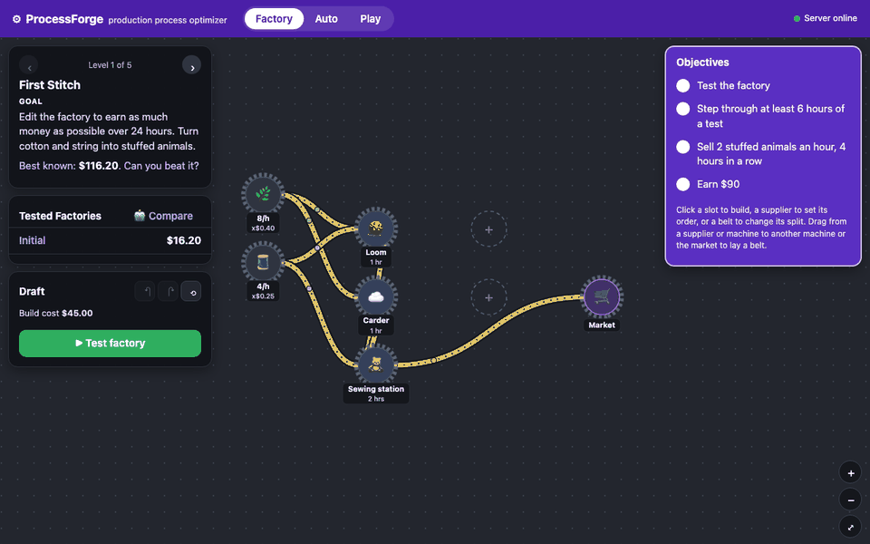
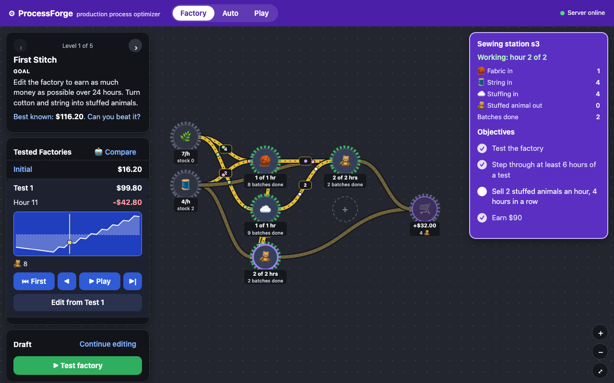
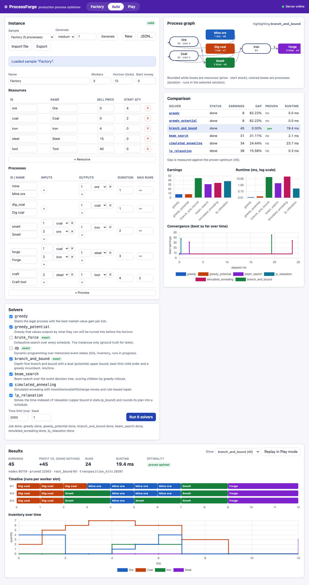
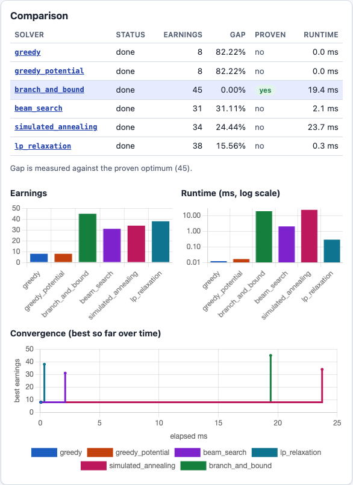
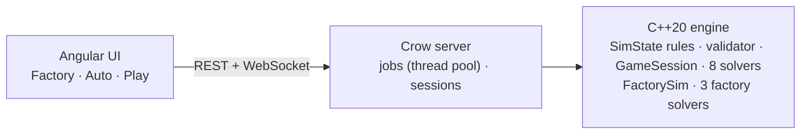

# ProcessForge

**A production-process optimizer with a C++20 engine, a Crow HTTP/WebSocket server, and an
Angular UI.** Given resources, recipes ("processes") that turn inputs into outputs over
time, a starting inventory, a limited number of workers, and a time horizon, find the
schedule that ends with the most valuable inventory.

Eight solvers (two greedy variants, exhaustive, dynamic programming, branch and bound, beam search,
simulated annealing, LP relaxation) run side by side, and every result is re-checked by an
independent validator. In **Play mode** you schedule the factory yourself, tick by tick,
then see how you rank against the algorithms.

**Factory mode** is a design game: build a toy factory on a D3-drawn floor (suppliers of
cotton, string, plastic, rubber and wood; looms, sewing stations, woodshops, assembly
benches; conveyor belts), test it over a simulated 24-hour day, step through it hour by hour,
and compare your design with three optimizers and a proven upper bound.



## Quick start

```bash
docker compose up --build
# open http://localhost:8080
```

Without Docker (CMake ≥ 3.25, a C++20 compiler, Node ≥ 22):

```bash
cmake -B build && cmake --build build -j
build/server/pf_server --instances instances          # API on :8080

cd web && npm ci && npm start                         # UI on :4200, proxies /api to :8080
```

## What you can do

**Factory mode** (the landing page): five levels, from one stuffed-animal line to a
four-toy factory on a budget. Click an empty slot to build a machine, a supplier to set
its hourly order, a belt to change how a node splits its output; drag from one node to
another to lay a belt. Every edit is checked by the server, with reasons ("s3 gets no
Fabric"). **Test factory** runs the design through the engine's `FactorySim`, adds it to
*Tested Factories*, and plays it back: machines show "1 of 2 hrs", "Blocked" or "Waiting",
belts show what they carried each hour, and a money chart scrubs through the day.
**Compare** runs the factory optimizers and adds their designs to the list. The rules are
in [docs/factory-spec.md](docs/factory-spec.md).



**Auto mode**: load a sample, generate a random instance, or edit one; run any set of
solvers with a time limit; watch them converge live over a WebSocket; compare earnings,
optimality gaps, proofs and runtimes; inspect any schedule as a Gantt chart with inventory
over time; see which processes it used on the process graph.



**Play mode**: start processes by hand, wait or skip to the next event, undo/redo or scrub
through history. Disabled Start buttons say why ("not enough Iron (need 2, have 0)").
*Challenge* hides the solvers until you finish and press Reveal; *Assist* gives hints from
an exact search of the rest of the game. Replay any solver's schedule step by step, export
your run as JSON, or share a link.

## Solver comparison

`factory` sample (5 processes, 3 workers, 12 ticks), 2 s limit:



Across generated instances (details and methodology in [docs/solvers.md](docs/solvers.md)):

| solver | idea | 200 small: mean gap | 10 medium: mean gap / proven |
|---|---|---|---|
| `greedy` | best market gain per tick | 6.94% | – |
| `greedy_potential` | gain valued at time-aware downstream potential | 1.93% | 16.23% / 0 |
| `brute_force` | exhaustive (tiny instances only; ground truth) | 0% | – |
| `dp` | memoized DP over canonical event states | 0% | solves 5 of 10 |
| `branch_and_bound` | DFS + admissible dual bound + greedy incumbent | 0% | 0.35% / 9 |
| `beam_search` | beam over the event tree, rollout-scored | 0.00% | 3.59% / 0 |
| `simulated_annealing` | local search with rule-based repair | 0.35% | 8.36% / 0 |
| `lp_relaxation` | time-indexed LP (in-house simplex) + rounding | 0.02% | 1.37% / 3 |

### Factory solvers

`pf_factory --time-limit 3000 instances/factory/*.json` (details in
[docs/solvers.md](docs/solvers.md#factory-solvers-factory-mode)):

| Level | Initial design | `greedy` | `local_search` | `flow_lp` | Upper bound |
|---|---|---|---|---|---|
| First Stitch | $16.20 | $99.80 | $116.20 | $85.80 | $317.51 |
| Up and Away | $67.80 | $184.40 | $184.40 | $105.20 | $389.46 |
| Rock Band | $6.40 | $183.00 | $224.60 | $219.00 | $639.40 |
| Full Line | $213.40 | $311.40 | $321.80 | $230.00 | $795.69 |
| Tight Budget | $7.40 | $205.60 | $232.60 | $205.60 | $569.65 |

## Benchmarks

Profiling showed the exact solvers spending more than half their time in `malloc`/`free`.
A compact canonical state, per-depth pooled buffers, and an open-addressing hash map
(identical search, same node counts) gave:

| benchmark | work | before | after | speedup |
|---|---|---|---|---|
| DP, `factory` | 36 k states | 257 ms | 39.2 ms | 6.6x |
| DP, medium #2 | 744 k states | 3925 ms | 566 ms | 6.9x |
| B&B, `factory` | 80 k nodes | 86.3 ms | 12.8 ms | 6.7x |
| B&B, medium #6 | 4.1 M nodes | 6529 ms | 1148 ms | 5.7x |
| B&B, medium #15 | 1.0 M nodes | 1174 ms | 186 ms | 6.3x |

Apple M-series, Release, one thread. Full table and the profile: [docs/solvers.md](docs/solvers.md#performance-m6).

## Architecture



The rules live in one class (`SimState`). The validator, Play-mode sessions, and the
timeline all run on it, and every solver's output is re-validated, so a solver cannot
misreport its score and a hand-played game is scored exactly like an algorithm's. More in
[docs/architecture.md](docs/architecture.md); the API contract is [docs/api.md](docs/api.md).

## The model

Time is discrete (`0..T`). Starting a process at tick `t` consumes its inputs immediately,
occupies one of `W` workers during `[t, t + duration)`, and adds its outputs at `t + duration`.
Runs must finish by `T`; inventory never goes negative; processes may have a `max_runs` cap.
At `T` everything is sold: earnings = start money + Σ quantity × sell price.
See `instances/` for hand-made examples with hand-computed optima.

## Running the tests

```bash
cmake -B build && cmake --build build -j && ctest --test-dir build      # engine + server
cmake -B build-asan -DPF_SANITIZE=ON && cmake --build build-asan -j && ctest --test-dir build-asan
cmake -B build-tsan -DPF_SANITIZE_THREAD=ON && cmake --build build-tsan -j --target pf_server_tests

cd web
npm test            # Vitest
npm run lint        # ESLint
npm run e2e         # Playwright (starts ../build/server/pf_server and ng serve)
```

Factory solvers on the bundled levels: `build/tools/pf_factory instances/factory/*.json`.
Benchmarks: `cmake -B build-bench -DPF_BUILD_BENCHMARKS=ON -DPF_BUILD_TESTS=OFF && cmake --build build-bench -j && build-bench/engine/bench/pf_bench`.
Solver comparison CLI: `build/tools/pf_compare --size medium --count 20`.

## Repository layout

```
engine/     C++20 library: model, rules, validator, GameSession, solvers, generator,
            factory/ (FactorySim, factory solvers) (+ tests, benchmarks)
server/     Crow HTTP/WebSocket server (+ integration tests)
tools/      pf_compare (solver comparison CLI) and pf_factory (factory solvers on levels)
web/        Angular app (+ Vitest, Playwright)
instances/  hand-made JSON instances; instances/factory/ holds the Factory-mode levels
docs/       architecture, API contract, solver write-ups, Factory rules, images
docker/     Dockerfiles and nginx config
```
