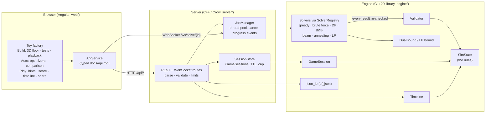
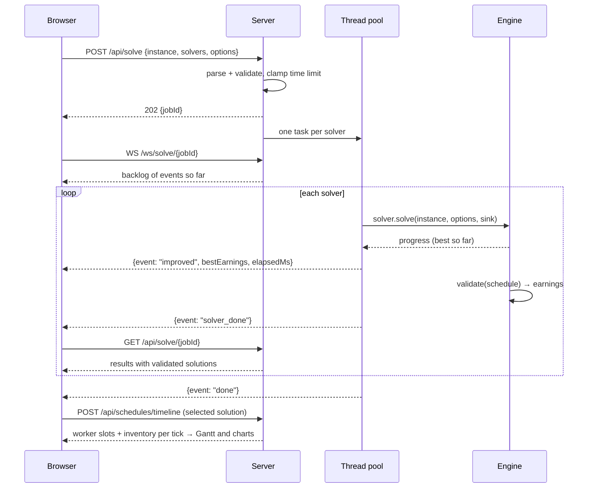
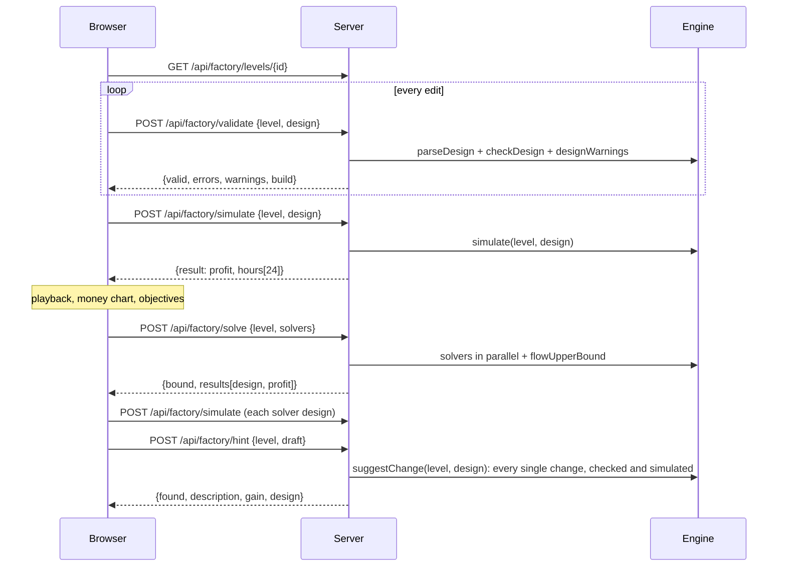

# Architecture

ProcessEngine has three layers. Game rules live in exactly one place per game (the engine's
`SimState` for scheduling, `FactorySim` for Factory mode); everything else calls into it.



## Engine (`engine/`)

A plain C++20 static library with no I/O and no third-party dependencies
(`pf_engine`), plus `pf_json` for JSON (nlohmann/json).

| Piece | Responsibility |
|---|---|
| `model.hpp` | `Resource`, `Process`, `Instance`, `Schedule`; `checkInstance` limits |
| `rules.hpp` — `SimState` | **The** implementation of the rules: legality of a start, consuming inputs, worker slots, completion events, horizon |
| `validator.hpp` | Replays a schedule on `SimState`; first violation or final earnings |
| `game_session.hpp` | Play mode: `SimState` plus history, undo/redo, legal actions, hints |
| `timeline.hpp` | Worker-slot layout and inventory per tick, for charts |
| `solver.hpp` | `Solver` (non-virtual `solve()` → virtual `solveRaw()`), `SolveOptions`, `Deadline`, `ProgressSink` |
| `registry.hpp` | Factory registry: list and construct solvers by name |
| `solvers/*` | The algorithms (see `docs/solvers.md`) |
| `bounds.hpp` | Admissible dual bound used by B&B and the LP solver |
| `generator.hpp`, `random.hpp` | Seeded, platform-independent instance generator |
| `factory/level.hpp` | Factory mode: `Level`, `Design`, `checkLevel`, `checkDesign` (spec error codes), warnings |
| `factory/sim.hpp` — `simulate` | **The** implementation of the Factory rules (`docs/factory-spec.md`): five steps per hour, per-hour report |
| `factory/hint.hpp` — `suggestChange` | The single change to a design that raises profit the most, every candidate checked and simulated |
| `factory/solvers.hpp` | `FactorySolver` (non-virtual `solve()` re-simulates), `greedy`, `local_search`, `flow_lp`, `flowUpperBound` |
| `factory/json.hpp` | Level and design parsing (in `pf_json`), report serialization |

**Why the validator cannot be fooled.** `Solver::solve()` is non-virtual: it times the
concrete `solveRaw()`, then validates the returned schedule and fills `Solution::earnings`
from the validator. A solver has no way to report its own score.

**Why Play mode and solvers agree.** `GameSession` and the validator both drive `SimState`,
so a manual game and a solver schedule are scored by the same code; a property test replays
1000 random games through the validator and requires identical earnings. The exact solvers
use a compact copy of the rules for speed (`src/solvers/compact_state.hpp`); a cross-check
test drives it and `SimState` side by side, and their output still goes through the
validator.

**Why Factory mode cannot be fooled either.** `FactorySolver::solve()` checks the design
with `checkDesign` and takes the profit from `simulate()`. The UI never computes a
score: tests, playback badges and objectives all come from the server's per-hour report.

## Server (`server/`)

A thin Crow wrapper (`pf_server_lib` + `pf_server`):

- **Routes** parse and validate requests (body size, unknown fields, solver names, clamped
  time limits) and translate engine errors into `{error, reason}` JSON with 4xx codes.
- **JobManager**: a fixed thread pool; each `(job, solver)` pair is a task. A job's
  `SolveOptions::cancel` points at the job's atomic flag, which `DELETE /api/solve/{id}`
  and shutdown set. A per-task `ProgressSink` turns solver progress into numbered events
  (throttled), appended to the job and pushed to WebSocket subscribers.
- **SessionStore**: `GameSession`s by random id, each with its own mutex; expiry after
  inactivity and a cap on live sessions; a background sweeper drops expired ones.
- **Factory routes** serve the bundled levels (parsed at startup) and validate, simulate
  and solve designs. Factory solves are short (at most 10 s) and run on the request,
  one thread per solver.
- Structured JSON logs (one line per request), CORS for local development, graceful
  shutdown (cancel running solves, join threads).

## Frontend (`web/`)

Angular (standalone components, signals, zoneless). The web app is one screen, the toy
factory (`web/src/app/factory/`); `ApiService` is the only place that knows URLs and covers
the factory endpoints. The scheduling engine's solvers and game sessions are served by the
same API (below) and used from the CLI tools. The frontend never re-implements rules: checks,
profits, hints and per-hour reports all come from the server.

`FactoryStore` holds the level, the draft design (undo/redo, saved per level in
localStorage), the server's check of it, the tested factories with their playback hour and
speed, the last Auto run and the last hint. `layoutFloor` (`floor-layout.ts`) lays the floor
out: suppliers, machines in columns by stage and the market. Belts are routed in four steps:
the side of each node they leave or enter, a fanned-out port per belt on that side, the gap
between columns they turn in (avoiding nodes), and a lane of their own in that gap, ordered so
their runs do not cross. Each gap is only as wide as its lanes need: a belt that changes rows
reserves one lane, in the least used gap it passes, so the floor stays compact. `FactoryLine3d` draws that layout in 3D with three.js as a toy
factory hall (`hallModel` in `line-3d-models.ts`: concrete floor with aisle lines and a
loading bay per truck, a back wall with a sign and a loading door, a street, a yard and trees
outside): a truck and crates per supplier, a machine model per machine with a storage
gauge, conveyors with rounded turns that bridge over the belts they cross, items riding the
running belts, and a floating model of what each node makes. Drag to orbit, scroll to zoom,
and drag from a supplier or machine to another node to lay a belt. Hovering or selecting a
node or belt fades everything outside its chain: all it is made from, back to the trucks,
and all it goes into, on to the market. Playback updates gauges, lamps and belts in place
each hour; models are merged into a few draw calls per material, items are instanced, and
shadows are drawn only when the floor changes. Each node also has a focusable button over
it, named after it, for the keyboard and screen readers. `MoneyChart` (D3 area chart,
also the hour scrubber), `ComparisonChart` (D3 bars against the best known profit and the
bound) and `MachineTimeline` (D3 grid of machine status per hour) are the charts. The right
panel has three tabs: Build (`FactoryInspector`), Auto (`FactoryAuto`) and Play
(`FactoryPlay`), and folds away to a strip of tab buttons; selecting something on the floor
opens it on Build. Icons are Lucide SVGs (`@ng-icons/lucide`); `icons.ts` maps each resource
to one, used both in the panels and in the floor's labels. Edits are pure functions in `design-ops.ts`.

## Data flows

### Scheduling: solve and stream (API)



### Scheduling: game session (API)

```mermaid
sequenceDiagram
  participant UI as Browser
  participant S as Server
  participant G as GameSession
  UI->>S: POST /api/sessions {instanceId}
  S->>G: new GameSession(instance)
  S-->>UI: state, legalActions, processStatus (why each Start is disabled)
  loop moves
    UI->>S: POST /actions {start_run | wait | advance_to}
    S->>G: apply(action) via SimState
    alt legal
      S-->>UI: 200 new state
    else illegal (UI prevents this; never trusted)
      S-->>UI: 409 {error, reason} + unchanged state
    end
  end
  UI->>S: POST /undo, /redo, /hint
  UI->>S: POST /finish
  S->>G: finish() → exported schedule → validator
  S-->>UI: solution + validated: true
  UI->>S: POST /compare {solvers}
  S-->>UI: {jobId} (a normal solve job on the same instance)
  UI->>S: POST /load {schedule of a solver}
  S->>G: restart + queue actions on the redo list
  UI->>S: POST /redo (step through the replay)
```

### Toy factory: edit, test, auto-build, hint



## Testing and tooling

| Layer | Tests |
|---|---|
| Engine | GoogleTest: Factory rules on a tiny level (pipeline timing, blocking, capacity, round-robin, demand tiers, error codes), every level's reference profits, factory solvers under the LP bound, hints that only ever raise profit; every rule violation, JSON errors, hand-made instances, property tests (1000 random instances × every solver vs brute force, deterministic seeds, game replay), bounds, timeline |
| Server | Integration tests over real HTTP and WebSocket: solve, cancel, limits, 4xx errors, sessions, expiry, cap, streaming |
| Web | Vitest component/unit tests (floor layout, including that no two belts share a stretch on any level, charts, design edits, objectives, share links); Playwright E2E (factory edit/drag/test/playback, Auto runs, hints, score, timeline, share links, level switching, folding the panel; fails on console errors or 409s) |
| CI | GCC and Clang `-Werror`, ASan + UBSan, TSan (server), clang-format, clang-tidy, ESLint, Prettier, benchmarks, `docker compose up` smoke test |
