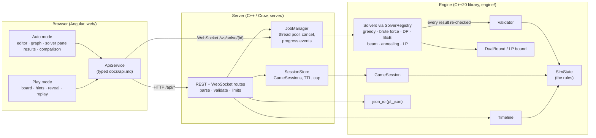
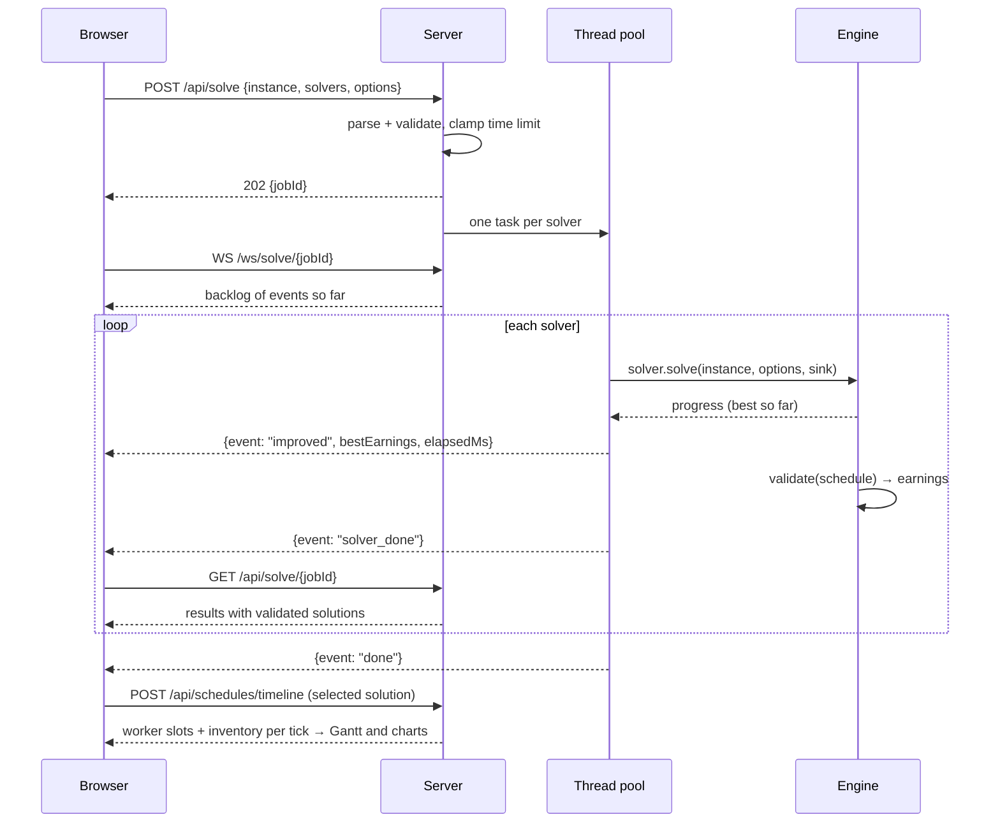

# Architecture

ProcessForge has three layers. Game rules live in exactly one place (the engine's
`SimState`); everything else calls into it.



## Engine (`engine/`)

A plain C++20 static library with no I/O and no third-party dependencies
(`pf_engine`), plus `pf_json` for JSON (nlohmann/json).

| Piece | Responsibility |
|---|---|
| `model.hpp` | `Resource`, `Process`, `Instance`, `Schedule`; `checkInstance` limits |
| `rules.hpp` — `SimState` | **The** implementation of the rules: legality of a start, consuming inputs, worker slots, completion events, horizon |
| `validator.hpp` | Replays a schedule on `SimState`; first violation or final earnings |
| `game_session.hpp` | Play mode: `SimState` plus history, undo/redo, legal actions, hints |
| `timeline.hpp` | Worker-slot layout and inventory per tick, for charts |
| `solver.hpp` | `Solver` (non-virtual `solve()` → virtual `solveRaw()`), `SolveOptions`, `Deadline`, `ProgressSink` |
| `registry.hpp` | Factory registry: list and construct solvers by name |
| `solvers/*` | The algorithms (see `docs/solvers.md`) |
| `bounds.hpp` | Admissible dual bound used by B&B and the LP solver |
| `generator.hpp`, `random.hpp` | Seeded, platform-independent instance generator |

**Why the validator cannot be fooled.** `Solver::solve()` is non-virtual: it times the
concrete `solveRaw()`, then validates the returned schedule and fills `Solution::earnings`
from the validator. A solver has no way to report its own score.

**Why Play mode and solvers agree.** `GameSession` and the validator both drive `SimState`,
so a manual game and a solver schedule are scored by the same code; a property test replays
1000 random games through the validator and requires identical earnings. The exact solvers
use a compact copy of the rules for speed (`src/solvers/compact_state.hpp`); a cross-check
test drives it and `SimState` side by side, and their output still goes through the
validator.

## Server (`server/`)

A thin Crow wrapper (`pf_server_lib` + `pf_server`):

- **Routes** parse and validate requests (body size, unknown fields, solver names, clamped
  time limits) and translate engine errors into `{error, reason}` JSON with 4xx codes.
- **JobManager**: a fixed thread pool; each `(job, solver)` pair is a task. A job's
  `SolveOptions::cancel` points at the job's atomic flag, which `DELETE /api/solve/{id}`
  and shutdown set. A per-task `ProgressSink` turns solver progress into numbered events
  (throttled), appended to the job and pushed to WebSocket subscribers.
- **SessionStore**: `GameSession`s by random id, each with its own mutex; expiry after
  inactivity and a cap on live sessions; a background sweeper drops expired ones.
- Structured JSON logs (one line per request), CORS for local development, graceful
  shutdown (cancel running solves, join threads).

## Frontend (`web/`)

Angular (standalone components, signals, zoneless). `ApiService` is the only place that
knows URLs; `models.ts` mirrors `docs/api.md`. `WorkspaceStore` holds the instance shared by
both modes; `SolveRun` wraps a job (submit, follow the WebSocket, refresh results, cancel)
and is reused for Auto-mode runs and the Play-mode reveal. Charts use Chart.js; the process
graph and Gantt timeline are hand-drawn SVG. The frontend never re-implements rules: legal
moves, disabled-button reasons, and chart timelines all come from the server.

## Data flows

### Auto mode: solve and stream



### Play mode: session

```mermaid
sequenceDiagram
  participant UI as Browser
  participant S as Server
  participant G as GameSession
  UI->>S: POST /api/sessions {instanceId}
  S->>G: new GameSession(instance)
  S-->>UI: state, legalActions, processStatus (why each Start is disabled)
  loop moves
    UI->>S: POST /actions {start_run | wait | advance_to}
    S->>G: apply(action) via SimState
    alt legal
      S-->>UI: 200 new state
    else illegal (UI prevents this; never trusted)
      S-->>UI: 409 {error, reason} + unchanged state
    end
  end
  UI->>S: POST /undo, /redo, /hint
  UI->>S: POST /finish
  S->>G: finish() → exported schedule → validator
  S-->>UI: solution + validated: true
  UI->>S: POST /compare {solvers}
  S-->>UI: {jobId} (a normal solve job on the same instance)
  UI->>S: POST /load {schedule of a solver}
  S->>G: restart + queue actions on the redo list
  UI->>S: POST /redo (step through the replay)
```

## Testing and tooling

| Layer | Tests |
|---|---|
| Engine | GoogleTest: every rule violation, JSON errors, hand-made instances, property tests (1000 random instances × every solver vs brute force, deterministic seeds, game replay), bounds, timeline |
| Server | Integration tests over real HTTP and WebSocket: solve, cancel, limits, 4xx errors, sessions, expiry, cap, streaming |
| Web | Vitest component/unit tests; Playwright E2E (Auto flow, full manual playthrough, replay, share links; fails on console errors or 409s) |
| CI | GCC and Clang `-Werror`, ASan + UBSan, TSan (server), clang-format, clang-tidy, ESLint, Prettier, benchmarks, `docker compose up` smoke test |
