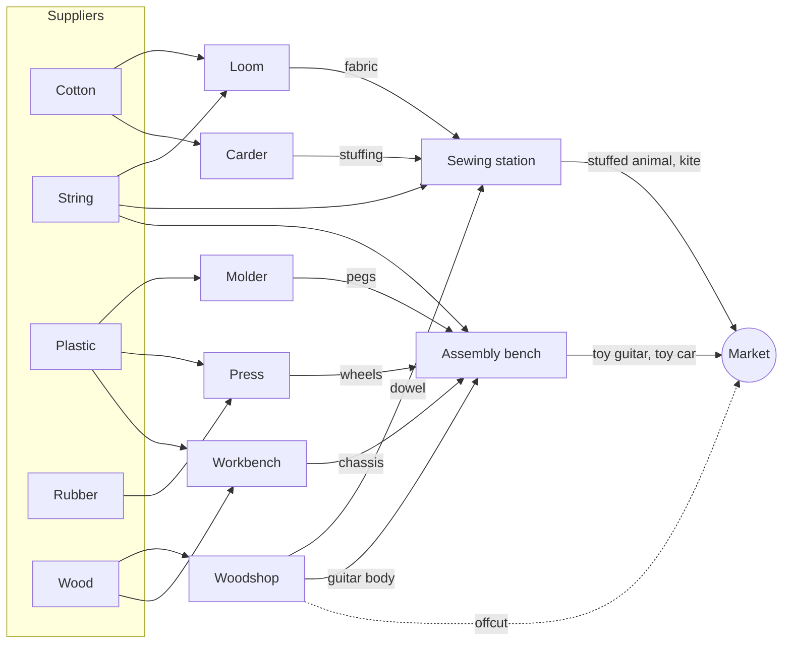

# Factory mode: rules

Factory mode is a design game. The player builds a toy factory (suppliers, machines,
belts), presses **Test**, and the factory runs for 24 simulated hours. The score is the
profit at the end. Unlike Play mode, the player does not act during the run; the design
is the whole decision.

This file is the single source of truth for the rules. The engine's `FactorySim`
implements exactly this, and the validator, the per-hour test playback, and every
factory solver run on `FactorySim`.

## Overview



## Concepts

| Concept | Defined by | Meaning |
|---|---|---|
| **Resource** | level | Something that moves on belts. `kind` is `raw`, `part` or `product` (display only). |
| **Supplier** | level | Delivers one raw resource. The design picks an **order rate** `0..max_rate` units per hour; every delivered unit costs `unit_cost`. |
| **Machine type** | level | A machine that can be built in a slot, with a one-time build `cost` and one or more **recipes**. |
| **Recipe** | level | `inputs` → `outputs` (resource → quantity), taking `hours` (≥ 1). One run of a recipe is a **batch**. |
| **Slot** | level | A place where the design may build one machine. |
| **Market** | level | Buys the resources it lists. Per listing: `price` for the first `demand` units sold in an hour, `overflow_price` for every further unit in that hour. |
| **Belt** | design | Carries one resource from a supplier or machine to a machine or the market, at most `belt_capacity` units per hour, with a split `weight`. |

All money is in **integer cents**. Time is in whole **hours** `h = 0 .. hours-1`
(the UI labels hour `h` as "Hour h+1").

## The design

A design chooses:

1. an order rate for each supplier (missing = 0),
2. for some slots, a machine type and one of its recipes (a machine runs one recipe for the
   whole test),
3. belts, each `{from, to, resource, weight}`.

Nodes are named by supplier id, slot id, or `"market"`.

A design is **valid** when all of the following hold. Each failure has an error code.

| Code | Rule |
|---|---|
| `unknown_supplier` | every order names a supplier of the level |
| `order_out_of_range` | `0 <= order <= max_rate` |
| `unknown_slot` / `slot_used_twice` | each machine names a slot of the level, at most once |
| `unknown_machine_type` / `unknown_recipe` | the type exists in the level and has that recipe |
| `over_budget` | if the level has a `budget`, the sum of build costs is at most `budget` |
| `unknown_node` | a belt's `from` is a supplier or a slot with a machine; its `to` is a slot with a machine or `"market"` |
| `belt_wrong_resource` | `from` can emit the resource: a supplier's resource, or an output of the machine's recipe |
| `belt_not_accepted` | `to` takes the resource: an input of the machine's recipe, or a market listing |
| `self_belt` / `duplicate_belt` | `from != to`; no two belts share `(from, to, resource)` |
| `weight_out_of_range` | `1 <= weight <= 10` (default 1) |
| `too_many_belts` | at most 256 belts |

Valid but suspicious designs get **warnings**, never errors: a machine input with no
incoming belt, a machine output with no outgoing belt (the machine will block), a
supplier with a non-zero order and no outgoing belt (stock piles up and is still paid for).

## Machine buffers

Each machine has an **input buffer** and an **output buffer** per resource of its recipe.
With `K = buffer_batches` (a level setting, default 2):

- input buffer for resource `r` holds at most `K × inputs[r]`,
- output buffer for resource `r` holds at most `K × outputs[r]`.

Suppliers have an unbounded output buffer (their stock). The market has no buffers.

A machine is **busy** while a batch runs. A batch that starts in hour `h` completes in hour
`h + hours`, so a 1-hour recipe can run back to back every hour.

## One hour, step by step

Every hour `h` runs these five steps in order. "In order" below means: suppliers in level
order, then slots in level order; resources in level order; belts in design order.

1. **Arrive.** Every unit dispatched in hour `h − 1` lands: into the target machine's input
   buffer, or at the market, where it is sold now. For each listing, of the `n` units that
   arrive at the market this hour, the first `min(n, demand)` earn `price` and the rest earn
   `overflow_price`.
2. **Complete.** Every batch due in hour `h` adds its outputs to the machine's output
   buffer; the machine is idle again.
3. **Start.** Every idle machine starts one batch if its input buffer holds all the
   recipe's inputs **and** each output buffer has room for a full batch of that output
   (`out[r] + outputs[r] <= K × outputs[r]`). Starting removes the inputs.
4. **Deliver.** Every supplier adds its order rate to its stock and charges
   `order × unit_cost`.
5. **Dispatch.** Every node with outgoing belts sends units from its output buffer (or
   stock), one unit at a time, resource by resource, until it runs out or no belt for that
   resource can take more. A belt can take a unit if
   - it has sent fewer than `belt_capacity` units this hour, and
   - its target is the market, or the target's input buffer has room:
     `in[r] + already dispatched to it this hour < K × inputs[r]`.

   Among the belts that can take the unit, the node picks one by **smooth weighted
   round-robin**: each such belt adds its `weight` to its `credit`; the belt with the
   highest credit (ties: first in design order) gets the unit and subtracts the sum of the
   eligible weights. Credits start at 0 and persist for the whole test, so over time each
   belt gets its weighted share. Example, weights A=2, B=1: A, B, A, A, B, A, ...

   Units dispatched now arrive in step 1 of the next hour. Units still on belts or in
   buffers when the test ends are worth nothing.

Every rule is deterministic, so a design always has exactly one score.

### Consequences worth knowing

- **Pipeline delay.** A unit takes one hour per belt, and each batch adds its hours. With
  the five-step order, a stuffed animal ordered as cotton in hour 0 is sold in hour 6 at the
  earliest (cotton → carder → sewing station → market).
- **Blocking.** A machine whose output nobody takes stops after `K` batches. The woodshop's
  guitar-body recipe also makes an offcut, so a guitar line jams unless the offcuts go
  somewhere (the market buys them as scrap, or a woodshop turns them into dowels).
- **Overbuying.** Ordered units are paid for even if they only pile up.
- **Wind-down.** Anything bought in the last hours cannot reach the market in time.

## Score

```
profit = sales − purchases − build costs
```

`build costs` are charged at the start (the money curve starts at `−build costs`). There is no
starting money and money may go negative during the test; only the final profit counts.

## Per-hour report

A test returns, for each hour: revenue, purchases, profit so far, units sold per product,
each machine's status after step 3 (`busy` with hours done / total; `blocked` when the
inputs are ready but an output buffer is too full; otherwise `starved`, with the missing
inputs), buffer contents, supplier stock, and units moved on each belt. The UI's playback,
charts and objectives use only this report.

## Level format (`processforge-factory/1`)

```json
{
  "format": "processforge-factory/1",
  "id": "first-stitch",
  "name": "First Stitch",
  "description": "...",
  "hours": 24,
  "belt_capacity": 10,
  "buffer_batches": 2,
  "budget": null,
  "resources": [{"id": "cotton", "name": "Cotton", "kind": "raw"}],
  "suppliers": [{"id": "cotton-supply", "resource": "cotton", "max_rate": 40, "unit_cost": 40, "x": 0, "y": 0}],
  "machine_types": [
    {"id": "loom", "name": "Loom", "cost": 1500,
     "recipes": [{"id": "fabric", "name": "Weave fabric", "inputs": {"cotton": 4, "string": 2},
                  "outputs": {"fabric": 2}, "hours": 1}]}
  ],
  "market": {"x": 8, "y": 2,
             "listings": [{"resource": "stuffed-animal", "price": 900, "demand": 3, "overflow_price": 500}]},
  "slots": [{"id": "s1", "x": 3, "y": 0}],
  "objectives": [{"kind": "profit", "at_least": 9000, "text": "Earn $90"}],
  "reference_designs": [
    {"name": "Initial", "initial": true, "design": {...}, "profit": 1620},
    {"name": "Best known", "design": {...}, "profit": 9980}
  ]
}
```

`x`, `y` are layout hints for the UI (grid cells); the engine ignores them.
`objectives` and `reference_designs` are level metadata. The reference design marked
`"initial": true` is the starting draft. Tests check that every reference design is valid
and scores exactly its `profit`.

### Design format

```json
{
  "orders": {"cotton-supply": 7, "string-supply": 4},
  "machines": [{"slot": "s1", "type": "carder", "recipe": "stuffing"}],
  "belts": [{"from": "cotton-supply", "to": "s1", "resource": "cotton", "weight": 1}]
}
```

### Objectives

| `kind` | Fields | Met when |
|---|---|---|
| `profit` | `at_least` | final profit ≥ `at_least` |
| `sold` | `resource`, `at_least` | total units of `resource` sold ≥ `at_least` |
| `rate` | `resource`, `per_hour`, `for_hours` | at least `per_hour` units of `resource` sold in each of `for_hours` consecutive hours |
| `run_test` | | the player ran a test (UI only) |
| `step_hours` | `hours` | the player stepped through `hours` hours of a test (UI only) |

Objectives are independent checkboxes: each one is met once any test of the level meets it.

### Limits

`hours` 1..168; at most 32 resources, 8 suppliers, 12 machine types, 4 recipes per
type, 24 slots, 256 belts; recipe quantities 1..1000; recipe hours 1..24;
`belt_capacity` 1..1000; `buffer_batches` 1..10; `max_rate` 0..1000; prices and costs
0..1 000 000 cents; `demand` 0..1000. Ids are 1–40 characters of `[a-z0-9-]`; `"market"`
is reserved.

## The toy catalog

Every level draws on one catalog. Money is shown in dollars here; files use cents.

### Suppliers

| Resource | Max rate (per hour) | Cost per unit |
|---|---|---|
| Cotton | 40 | $0.40 |
| String | 24 | $0.25 |
| Plastic | 20 | $0.50 |
| Rubber | 12 | $0.60 |
| Wood | 16 | $0.80 |

### Machines

| Machine | Build cost | Recipe | Inputs → outputs | Hours |
|---|---|---|---|---|
| Loom | $15 | `fabric` | 4 cotton + 2 string → 2 fabric | 1 |
| Carder | $10 | `stuffing` | 3 cotton → 4 stuffing | 1 |
| Sewing station | $20 | `stuffed-animal` | 2 fabric + 4 stuffing + 2 string → 2 stuffed animals | 2 |
| | | `kite` | 1 fabric + 2 dowels + 2 string → 1 kite | 1 |
| Woodshop | $18 | `guitar-body` | 3 wood → 1 guitar body + 1 offcut | 2 |
| | | `dowel` | 1 wood → 3 dowels | 1 |
| | | `dowel-offcut` | 1 offcut → 2 dowels | 1 |
| Molder | $12 | `pegs` | 1 plastic → 4 tuning pegs | 1 |
| Press | $15 | `wheels` | 2 rubber + 1 plastic → 4 wheels | 1 |
| Workbench | $12 | `chassis` | 2 wood + 3 plastic → 2 chassis | 1 |
| Assembly bench | $25 | `toy-guitar` | 1 guitar body + 3 string + 4 pegs → 1 toy guitar | 2 |
| | | `toy-car` | 2 chassis + 8 wheels → 2 toy cars | 2 |

### Market

| Product | Price | Demand (per hour) | Overflow price |
|---|---|---|---|
| Stuffed animal | $9.00 | 3 (2 in levels 2–3) | $5.00 |
| Toy guitar | $28.00 | 1 | $16.00 |
| Toy car | $13.00 | 2 | $7.00 |
| Kite | $8.00 | 2 | $4.50 |
| Wood offcut (scrap) | $0.10 | 99 | $0.10 |

Where the decisions come from: string feeds four recipes from one capped supplier; fabric and
the sewing stations are shared by stuffed animals and kites; the assembly bench is shared by
guitars and cars; guitar bodies leave offcuts that either jam the woodshop, sell as scrap,
or become free kite dowels; and demand caps make a single-product factory sell at overflow
prices.

## Levels

Files: `instances/factory/N-id.json`. All levels last 24 hours, with belt capacity 10 and
buffers of 2 batches.

| # | Level | Slots | Budget | Products | Teaches | Initial | Best known | Upper bound |
|---|---|---|---|---|---|---|---|---|
| 1 | First Stitch | 5 | – | stuffed animal | placing machines, belts, testing, stepping | $16.20 | $116.20 | $317.51 |
| 2 | Up and Away | 7 | – | + kite | sharing fabric and sewing stations, split weights | $67.80 | $184.40 | $389.46 |
| 3 | Rock Band | 8 | – | stuffed animal, toy guitar | slow batches, blocking (the initial design jams on offcuts) | $6.40 | $224.60 | $639.40 |
| 4 | Full Line | 10 | – | all four | demand caps, choosing a product mix | $213.40 | $331.60 | $795.69 |
| 5 | Tight Budget | 8 | $130 | all four, + `dowel-offcut` | a build budget, reusing offcuts | $7.40 | $232.60 | $569.65 |

"Best known" is the best of three 10-second `local_search` runs (`pf_factory`, seeds 1–3);
it is a lower bound, not a proven optimum. "Upper bound" is the flow LP relaxation
(`flowUpperBound`), which ignores timing, belts and whole machines, so it is loose. The level
files store each best-known design, and the engine's tests pin its profit.

| Level | Best known design | Orders per hour | Sales | Purchases | Build | Profit |
|---|---|---|---|---|---|---|
| 1 | loom, carder, 2 × sewing (animals) | cotton 8, string 5 | $288.00 | $106.80 | $65.00 | **$116.20** |
| 2 | 2 × loom, carder, woodshop (dowels), 2 × sewing (animals), sewing (kites) | cotton 9, string 7, wood 1 | $450.00 | $147.60 | $118.00 | **$184.40** |
| 3 | loom, carder, sewing (animals), 2 × woodshop (bodies), molder, 2 × assembly (guitars) | cotton 4, string 5, plastic 1, wood 5 | $544.00 | $176.40 | $143.00 | **$224.60** |
| 4 | as level 3 + a second sewing station and a press | cotton 8, string 9, plastic 1, wood 3 | $710.00 | $200.40 | $178.00 | **$331.60** |
| 5 | loom, carder, 2 × sewing (animals), woodshop (bodies), molder, assembly (guitars) | cotton 8, string 7, plastic 1, wood 3 | $541.00 | $188.40 | $120.00 | **$232.60** |

The level 4 press never runs (no rubber is ordered), yet removing it costs $69: it takes
a share of the single plastic per hour, which spaces out peg production so guitars rarely
arrive two in the same hour (when the second one sells at the overflow price). Timing is
part of the game.

Level 2's objectives ("sell 10 kites", "earn $120") can be met together: the best-known
design sells 18 kites, and the reference design "Alternative 1" sells 28 kites for $120.40.

## Worked example (hand-checked)

Level 1, initial design: loom (s1), carder (s2), one sewing station (s3); orders cotton 8,
string 4; belts cotton → loom and carder, string → loom and sewing, fabric and stuffing →
sewing, animals → market.

| Hour | What happens |
|---|---|
| 0 | 8 cotton and 4 string delivered ($4.20). Round-robin sends cotton loom, carder, loom, ... (4 each) and string loom, sewing, ... (2 each). |
| 1 | They arrive. The loom (4 cotton + 2 string) and the carder (3 cotton) start. The sewing station has string only. |
| 2 | Both complete: 2 fabric, 4 stuffing, dispatched to the sewing station. |
| 3 | The sewing station has 2 fabric + 4 stuffing + 2 string and starts (2 hours). |
| 5 | It completes 2 animals, dispatched; it starts again with inputs that arrived in hour 4. |
| 6 | 2 animals sold at $9.00 (demand 3). |
| 6–23 | The sewing station is the bottleneck: one batch every 2 hours, so 2 animals sell in hours 6, 8, ..., 22. The loom and carder block on full output buffers every other hour, and supplier stock piles up (80 cotton, 38 string unused at the end). The batch completing in hour 23 is dispatched but would arrive in hour 24, after the end. |

```
sales      = 9 sales × 2 animals × $9.00          = $162.00
purchases  = 24 hours × (8 × $0.40 + 4 × $0.25)   = $100.80
build      = $15 + $10 + $20                       =  $45.00
profit     = 162.00 − 100.80 − 45.00               =  $16.20
```

A separate reference model (a short script used to tune the levels), the hand calculation
and the engine's `FactorySim` agree on every number above; the engine tests
(`engine/tests/factory_test.cpp`) pin this example and every reference design's profit.
